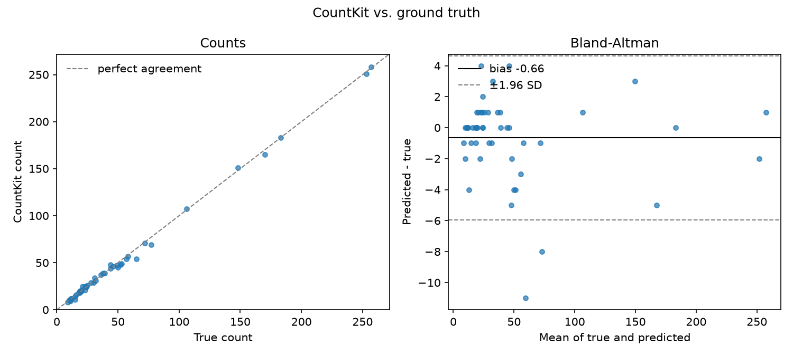
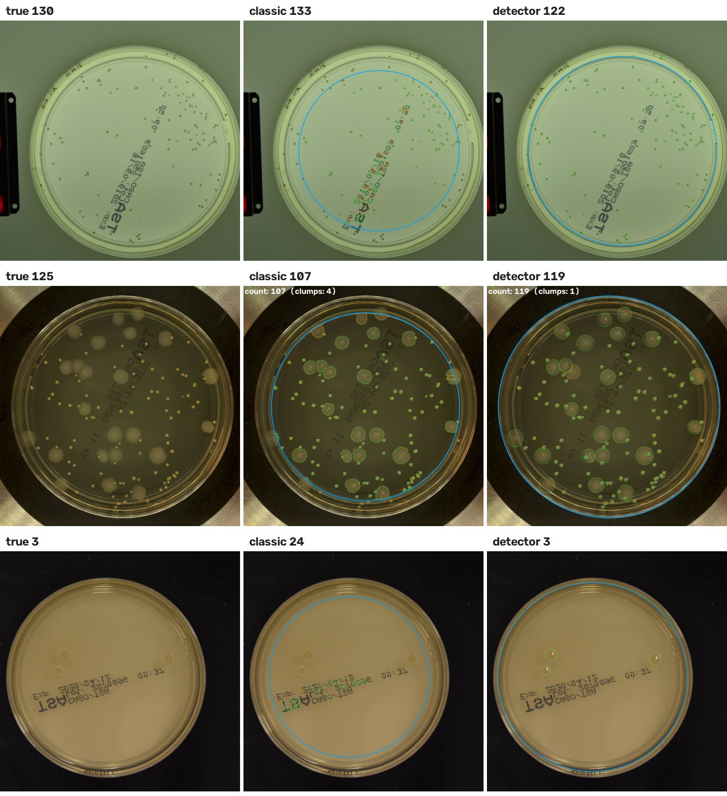
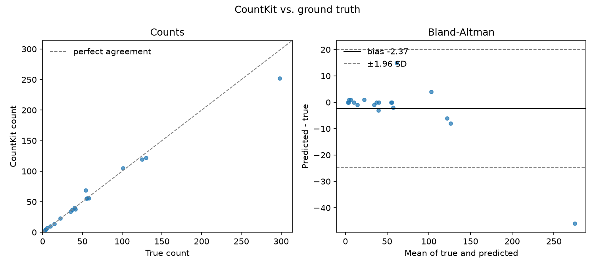
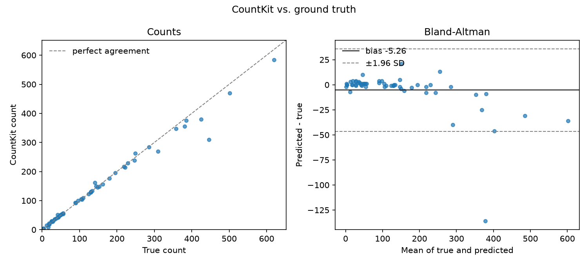
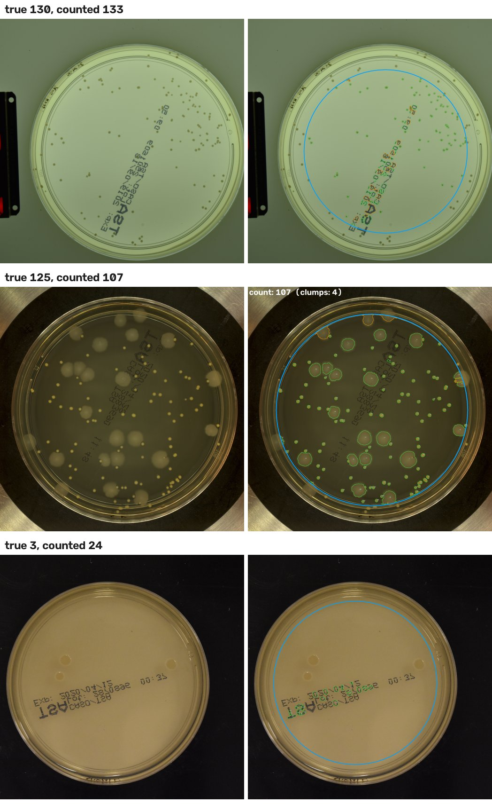
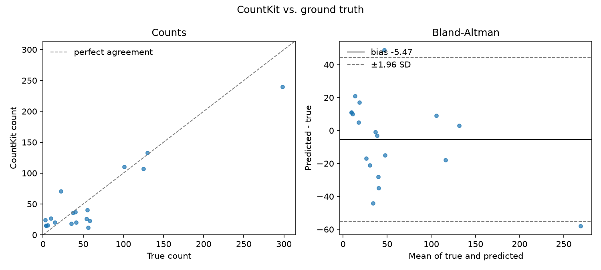

# CountKit: Colony and Cell Counting from Images

> Drop in a folder of plate photos or microscope images, get a count for every image in a CSV, plus overlay pictures so you can see exactly what got counted.

---

## Table of Contents

1. [Overview](#overview)
2. [Background](#background)
3. [Goals](#goals)
4. [Datasets](#datasets)
5. [Pipeline](#pipeline)
6. [Repository Structure](#repository-structure)
7. [Results](#results)
8. [Installation & Usage](#installation--usage)
9. [Output Files](#output-files)
10. [Reproducibility](#reproducibility)
11. [Future Directions](#future-directions)
12. [References](#references)
13. [Contact](#contact)

---

## Overview

CountKit counts things in images. It has two modes that share one interface:

- **`plate`**: bacterial colonies on agar plates
- **`cells`**: cells or nuclei in microscope images

You point it at a folder, pick a mode, and it gives you back:

1. `counts.csv`: one row per image (count, size stats, flags)
2. `objects.csv`: one row per counted object (position, area, shape)
3. `overlays/`: a copy of every image with each counted object outlined and numbered

There's also a small review page where you can flip through the overlays, click to add colonies it missed, and remove ones it shouldn't have counted. Your corrections get saved next to the original counts, so you never have to redo a whole plate because of one mistake.

**How accurate is it?** On real plates it never saw during training, the colony detector's count is a median **2.6% to 4.0%** off the hand count (76 plates from two public datasets). For cells, Cellpose is a median 3.0% off on 50 real nuclei images. Details and the misses are in [Results](#results).


*Left: a plate photo. Right: the overlay CountKit writes. The blue circle is the area that gets counted, so the rim and the label are left out.*

---

## Background

Counting colonies by hand is one of the most tedious jobs in a lab. You sit with a marker and a clicker, dot every colony on the back of the plate, and hope you didn't lose track halfway through. It takes a few minutes per plate, and two people counting the same plate often get different numbers.

Cell counting from microscope images has the same problem at a smaller scale. Hundreds of cells per field, lots of fields per experiment.

Both jobs come down to the same three steps: **find the objects, count them, measure them**. So CountKit handles both with one tool and one output format.

**Why two engines?**

| Mode | Engine | Why |
|------|--------|-----|
| `plate` | **Colony detector** (Faster R-CNN, trained), the default when installed | Trained on about 40,000 colonies that people boxed by hand, so it learned what thresholding can't: printed text on the dish isn't a colony, and two soft colonies touching are two. About 1 s per plate. |
| `plate` | Classic image processing (OpenCV + scikit-image) | Thresholding and a watershed. No PyTorch or model download, and fine on clean synthetic plates, but on real plates it's a ballpark only (see [Results](#results)). Used when the detector isn't installed. |
| `cells` | [Cellpose](https://github.com/MouseLand/cellpose) (pretrained deep learning) | Cells come in every shape and touch each other constantly. Cellpose was trained on a large set of cell images and deals with that much better than thresholding. |
| `cells` | Classic fallback | Threshold + watershed. Used when Cellpose isn't installed. Good enough for clean fluorescent nuclei. |

**Why overlays?**
A number on its own isn't worth much. If a tool says "143 colonies" you have no idea whether it counted a bubble, missed a cluster, or counted the label on the plate. The overlay shows every counted object with a number on it, so you can check it in a few seconds and trust the CSV.

---

## Goals

- Count colonies and cells from images with no manual clicking
- Use the same CSV format for both modes so downstream analysis doesn't care which one you ran
- Make every count checkable by eye through overlays
- Make fixing mistakes quick instead of all or nothing
- Measure accuracy against known counts and report the real numbers

---

## Datasets

| Dataset | Used for | Status |
|---------|----------|--------|
| **Synthetic plates** (`countkit demo`) | Testing and the numbers in [Results](#results) | Included. Generated by `countkit/synth.py` with known counts |
| **Synthetic nuclei** (`countkit demo`) | Testing and the numbers in [Results](#results) | Included. Generated by `countkit/synth.py` with known counts |
| **DSB2018 nuclei** (real) | Real cell validation | **Done.** 50 test images, both engines, results below |
| **ADBC plates** (real, hand boxed) | Training and testing the colony detector | **Done.** 369 plates, 57 held out for testing, results below |
| **AGAR demo plates** (real, hand counted) | Real plate validation | **Done.** 39 plates, 20 for tuning/training and 19 held out, results below |
| **Real plate photos** (8, no hand counts) | Checking plate mode on real photos by eye | **Done.** Found and fixed 3 bugs, see [Results](#results) |
| [AGAR full set](https://agar.neurosys.com/) (18,000 plates) | Bigger plate validation | Not run. Needs a free sign-up. One command ready: `scripts/run_real_tests.sh` |
| [BBBC005](https://bbbc.broadinstitute.org/BBBC005) | More cell validation | Not run yet. Script ready: `scripts/truth_from_bbbc005.py` |

**DSB2018** is a set of real fluorescence microscope images of nuclei from the 2018 Data Science Bowl, where every nucleus was outlined by hand. I used the copy the StarDist project hosts on GitHub ([`dsb2018.zip`](https://github.com/stardist/stardist/releases/download/0.1.0/dsb2018.zip)), which is already split into 447 training images and 50 test images. The true count for each image is the number of hand-drawn outlines (`scripts/truth_from_masks.py`). The data isn't stored in this repo.

**ADBC** (Annotated Dataset for Bacterial Colony detection, [Makrai et al. 2023](https://doi.org/10.1038/s41597-023-02404-8)) is 369 plate photos of 24 bacterial species, with 56,865 colonies boxed by hand. It's on [Figshare](https://doi.org/10.6084/m9.figshare.22022540) under CC BY 4.0. I split it per species with a fixed seed (`scripts/train_detector.py`): 15% test (57 plates), 15% validation (57), the rest training (255). The true count is the number of hand-drawn boxes.

**AGAR** is a set of agar plate photos from NeuroSYS where every colony was boxed by hand. The full set is about 18,000 plates and needs a sign-up. The free demo on [agar.neurosys.com](https://agar.neurosys.com/) has 40 plates in 4 groups of 10: bright background, dark background, "vague" (low contrast) and lower resolution. One plate is marked -1 (too crowded to count), so 39 have a true count. The true count is `colonies_number` in each plate's JSON file. `scripts/agar_split.py` splits the demo the same way every time: 20 tuning plates and 19 held out (its docstring has the exact recipe). Both plate engines use this one split: the classic engine was tuned on the 20 tuning plates, the detector trained on 16 of them and picked its score cutoff using the other 4, and both are scored only on the 19 held-out plates. AGAR is licensed CC BY-NC 2.0 (free for non-commercial use, with credit). The photos aren't stored in this repo, apart from the small example figures below.

**Real plate photos** are the 8 example scans in [leodr/colony-detection](https://github.com/leodr/colony-detection) (MIT License, Copyright (c) 2024 Leonhard Driesch): lactic acid bacteria on MRS agar, 3040 x 3040 px. They don't come with hand counts, so they show whether plate mode works on real photos, not how accurate it is.

> **Be clear about what the synthetic numbers mean.** The synthetic images are much cleaner than real plates and real cells: even lighting, round objects, no bubbles, no condensation, no scratches. They show the code works and the counting logic is right. They do **not** tell you how accurate CountKit is on real lab images. The DSB2018 numbers are the real ones for cells, and the ADBC and AGAR numbers are the real ones for plates.

> Check the license on each dataset before you share anything built from it.

---

## Pipeline

### Part 1: Load

- Reads PNG, JPG, TIFF, BMP
- 16-bit microscope TIFFs get stretched to 8-bit (0.5 to 99.5 percentile) so every image is handled the same way

### Part 2a: Plate mode (`countkit/plate.py`)

1. **Find the plate and fix the scale.** A Hough circle search finds the dish. The photo is scaled so the plate is 400 px in radius (big photos shrink, small ones grow), so the same plate gets the same count whatever the photo size, and the size settings (`--min-area`, `--max-area`, `--min-distance`) mean the same thing on every plate. They're in pixels at this scale. Counts and outlines are mapped back to the original photo. Only the inner 85% of the radius is kept (`--rim`), which cuts out the rim glare and the dish wall. Colonies right at the edge get skipped because of this. If no dish is found, the whole image is used and the image gets a `no_plate_found` flag.
2. **Remove the background.** A light blur, then a wide median filter (60% of the plate radius) estimates the agar, and it gets subtracted. This handles uneven lighting, works whether colonies are lighter or darker than the agar, and is wide enough that big soft colonies stay whole instead of turning into rings.
3. **Threshold.** Otsu's method on what's left, inside the plate only.
4. **Fill ring-shaped colonies.** Some colonies have a pale edge and a center close to the agar color. Their holes get filled first, or the next step cuts each ring into pieces.
5. **Split touching colonies.** Distance transform + watershed (`countkit/split.py`). How close two centers can be before they're split follows the typical colony size on that plate, because colony size varies about 10x between plates.
6. **Filter.** Drops specks smaller than `--min-area`, blobs bigger than `--max-area` (glare, smears, labels), and shapes that don't look like a colony: thin arcs from the dish wall, and most printed letters (not solid enough or too stretched out).
7. **Check for crowding.** If colonies (or a lawn) cover most of the plate, it gets a `crowded_plate` flag, since single colonies can't be told apart anymore.

### Part 2a (detector): Plate mode with the trained colony detector (`countkit/detector.py`)

1. **Crop to the plate.** Same plate search as the classic engine. The photo is cropped to a square just around the dish and scaled to 1024 x 1024 px.
2. **Detect.** A Faster R-CNN (ResNet-50 FPN v2, from torchvision) finds a box around every colony. Its anchor boxes are sized for colonies (8 to 128 px) instead of everyday objects. A box counts if the model is at least 60% sure; that cutoff was picked on the validation plates and is saved in the weights file (`--score` overrides it).
3. **Hand off.** Boxes are mapped back to the original photo and each one is drawn as a filled ellipse, so the CSVs, overlays and review page work exactly like the other engines. Areas from this engine are ellipse estimates.

There's no rim cut: the model learned where the dish wall is, so colonies right at the edge count too. It runs on the GPU if there is one (NVIDIA or Apple silicon), otherwise the CPU.

**Training** (`scripts/train_detector.py`): starts from torchvision's COCO weights, then 15 passes over 271 training plates (255 ADBC + 16 AGAR, 40,115 colonies) with random flips, turns and color changes, on random 512 px pieces of each 1024 px plate (whole crowded plates ran out of memory). It took about 85 minutes on a MacBook Air (Apple M5 GPU). Training and counting use the same `prepare()` step, so the model always sees plates the same way.

### Part 2b: Cells mode (`countkit/cells.py`)

- **Cellpose engine:** runs the pretrained model and takes its masks as is. With Cellpose 4 (what `pip` installs today) that's Cellpose-SAM, its one built-in model. With Cellpose 3 it's `cyto3` (change with `--model`). It uses the GPU if there is one (NVIDIA, or Apple silicon)
- **Classic engine:** blur, flatten illumination with a morphological opening, Otsu threshold, watershed split
- `--engine auto` uses Cellpose if it's installed and falls back to classic if it isn't

### Part 3: Measure (`countkit/measure.py`)

For every object: center (x, y), area, equivalent diameter, circularity.

**Clump flag:** an object is flagged as a possible clump if it's more than 2x the median area **and** not convex (solidity under 0.9). Size alone isn't used, because a big round colony is still one colony.

**Image flags:**

| Flag | Meaning |
|------|---------|
| `no_plate_found` | No dish circle was found, so the whole image was used |
| `large_blob_removed` | Something bigger than `--max-area` was thrown out. Worth a look |
| `crowded_plate` | Growth covers most of the plate. The count is not reliable, treat it as "too many to count" or replate a dilution |
| `low_count` | Fewer than 3 objects |
| `many_clumps` | Over 20% of objects are flagged clumps, so the count is probably low |
| `no_cells_found` | Cells mode found nothing |

### Part 4: Overlay (`countkit/overlay.py`)

- Green outline = counted object, orange = flagged clump
- Every object numbered (the number matches `object_id` in `objects.csv`)
- Blue circle = the counting area in plate mode
- Total count printed in the corner

### Part 5: Review (`countkit/review_app.py`)

A Streamlit page:

- Flip through images with Previous / Next
- **Click** on a missed object to add it
- **Pick numbers** from a list to remove false hits
- **Save** writes `corrections.json` and `counts_corrected.csv`

### Part 6: Validate (`countkit/validate.py`)

Compares `counts.csv` to a truth file (`image,true_count`) and reports:

- Mean absolute error, mean and median % error
- Share of images within ±5% and ±10%
- Bias (does it over or undercount?)
- Pearson r
- An agreement plot and a Bland-Altman plot

---

## Repository Structure

```
countkit/
│
├── README.md                        # This file
├── RESULTS.md                       # Walkthrough of every output + current numbers
├── pyproject.toml                   # Package + `countkit` command
├── requirements.txt                 # Pinned-ish dependencies
├── LICENSE
├── .gitignore
│
├── countkit/
│   ├── cli.py                       # count / validate / demo / review commands
│   ├── io.py                        # Finding and loading images
│   ├── plate.py                     # Colony engine (classic)
│   ├── detector.py                  # Colony engine (trained Faster R-CNN detector)
│   ├── cells.py                     # Cellpose + classic cell engines
│   ├── split.py                     # Watershed for touching objects
│   ├── measure.py                   # Per-object stats, per-image summary, clump flag
│   ├── overlay.py                   # Outlined + numbered overlay images
│   ├── pipeline.py                  # Runs a folder, writes CSVs and overlays
│   ├── validate.py                  # Accuracy vs. ground truth + plots
│   ├── corrections.py               # Load/save/apply manual fixes
│   ├── review_app.py                # Streamlit review page
│   └── synth.py                     # Synthetic images with known counts
│
├── scripts/
│   ├── run_real_tests.sh            # Rerun every real-data test in one command
│   ├── train_detector.py            # Train + test the colony detector (ADBC + AGAR)
│   ├── agar_split.py                # The one AGAR tuning / held-out split both plate engines use
│   ├── truth_from_agar.py           # Build truth.csv from AGAR annotations
│   ├── truth_from_bbbc005.py        # Build truth.csv from BBBC005 file names
│   └── truth_from_masks.py          # Build truth.csv from instance masks (DSB2018, BBBC039)
│
├── tests/
│   ├── test_engines.py              # Plate finding, scaling, counting, splitting
│   ├── test_detector.py             # Detector crop math, boxes to objects, weights, download check
│   ├── test_pipeline.py             # Output format, bad files, validation math, corrections, CLI
│   └── test_review.py               # Review page: removing, switching images, saving
│
└── docs/images/                     # Figures used in this README
```

---

## Results

### Real data: DSB2018 nuclei (Cellpose engine)

Same 50 held-out test images as the classic engine below, 9 to 257 nuclei each, 2,460 nuclei in total. Cellpose 4.2 (Cellpose-SAM), default settings, nothing tuned.

| Metric | Cellpose | Classic |
|--------|----------|---------|
| Total nuclei (true / counted) | 2,460 / 2,427 | 2,460 / 2,323 |
| Exact count | 16 / 50 | 7 / 50 |
| Mean absolute error | 1.70 nuclei | 5.66 nuclei |
| Mean absolute % error | **4.67%** | 12.29% |
| Median absolute % error | **3.03%** | 10.66% |
| Within ±5% | 66.0% of images | 22.0% of images |
| Within ±10% | 88.0% of images | 48.0% of images |
| Bias | -0.66 | -2.74 |
| Pearson r | 0.9989 | 0.9935 |
| Time per image | 2.21 s (Apple M5 GPU) | 0.024 s (Apple M5 CPU) |



**What this means:** Cellpose is about 2.6x more accurate than the classic engine on real nuclei, and it fixes the classic engine's worst case. The two crowded images the classic engine got wrong by about 13% (true 257 and 253) come out as 258 and 251. Its biggest miss is an image with 65 nuclei counted as 54. It's about 90x slower, but 2 seconds an image is still far quicker than counting by hand.

**One caveat:** Cellpose-SAM was trained on a big mix of public cell images, which may include DSB2018. If so, this score is a bit better than what you'd get on images it has never seen.

### Real data: DSB2018 nuclei (classic engine)

50 held-out test images, 9 to 257 nuclei each, 2,460 nuclei in total.

| Metric | Value |
|--------|-------|
| Total nuclei (true / counted) | 2,460 / 2,323 |
| Exact count | 7 / 50 |
| Mean absolute error | 5.66 nuclei |
| Mean absolute % error | 12.29% |
| Median absolute % error | 10.66% |
| Within ±5% | 22.0% of images |
| Within ±10% | 48.0% of images |
| Bias | -2.74 (undercounts) |
| Pearson r | 0.9935 |
| Time per image | 0.024 s mean |

**How it was tested:** the one setting that mattered (`min_distance`, how close two nuclei can be before they get split) was tuned on the 447 **training** images only. The best value there was 7 px, so that's now the default for cells. Then the 50 **test** images were run once. Before tuning, the test score with the old default was 15.89% mean absolute % error.

**Where it goes wrong:**

- Crowded fields with both bright and dim nuclei. One threshold for the whole image picks up the bright ones and misses some dim ones. The two worst test images had 257 and 253 nuclei and were counted as 222 and 219.
- Nuclei touching end to end sometimes get merged (orange outlines), and long nuclei sometimes get cut in two.
- Errors go both ways: 19 images overcounted, 24 undercounted, 7 exact.


*Left: real images. Right: CountKit overlays. Top: a typical image (true 20, counted 23). Middle and bottom: the two worst misses (true 257 and 253, counted 222 and 219).*


**What this means:** the classic engine is fine for a rough count on clean fluorescent nuclei, but around 1 in 2 images comes out more than 10% off. That's why Cellpose is the main engine for cells mode.

### Real data: plates, colony detector

Two sets of real plates the detector never saw during training, scored with `countkit count --engine detector` on the original photos:

| Metric | AGAR held-out (19 plates) | ADBC test (57 plates) |
|--------|---------------------------|-----------------------|
| Colonies per plate | 3 to 298 | 2 to 620 |
| Total colonies (true / counted) | 1,094 / 1,049 | 7,986 / 7,686 |
| Mean absolute error | 4.68 colonies | 8.32 colonies |
| Mean absolute % error | 6.56% | 7.63% |
| Median absolute % error | **3.96%** | **2.63%** |
| Within ±5% | 63.2% of images | 66.7% of images |
| Within ±10% | 78.9% of images | 78.9% of images |
| Bias | -2.37 | -5.26 |
| Pearson r | 0.9944 | 0.9919 |
| Time per image | 1.03 s median (Apple M5 GPU) | 1.03 s median |

**Compared with the classic engine on the same plates:**

| Median absolute % error | Classic | Detector |
|---|---|---|
| AGAR held-out (19) | 51.22% | **3.96%** |
| ADBC test (57) | 24.62% | **2.63%** |



*Three AGAR held-out plates. Left: photo with the hand count. Middle: classic engine. Right: detector. Top: the classic total was close only because about 20 pieces of text made up for skipped edge colonies; the detector finds the colonies themselves, including at the edge. Middle: soft colonies that touch are split correctly. Bottom: the classic engine counted 24 pieces of printed text; the detector found the 3 real colonies and ignored the text.*

**How it was tested:** the score cutoff (0.6) was picked on 61 validation plates (57 ADBC + 4 AGAR). The 76 test plates above were only used for these numbers, after training was finished. The 19 AGAR plates are the same held-out plates the classic engine is scored on.

**Where it goes wrong:**

- **Tiny pinpoint colonies,** especially on dark blood agar. At 1024 px they're only about 5 px across. The worst ADBC test plate had 446 colonies and was counted as 310. On the 8 ADBC test plates with 300 or more colonies it undercounts by a median 6.4%. A 2048 px version would likely fix most of this (see [Future Directions](#future-directions)).
- **Plates with very few colonies:** being off by 1 or 2 is a big percentage (true 3, counted 1; true 2, counted 3).
- **AGAR plate 734** (true 54, counted 69): this plate also has 24 colonies AGAR boxed as "Contamination" and left out of its count. The detector counts every colony, so most of that gap is the contamination.
- By AGAR group (median error): lower resolution 0.0%, vague 0.0%, dark 4.0%, bright 20.2% (bright has the 734 plate and the busiest plate, 298 counted as 252).





**About the weights:** they were trained partly on AGAR, which is CC BY-NC 2.0, so treat the weights as **non-commercial use only**. ADBC is CC BY 4.0. The CountKit code itself stays Apache 2.0.

### Real data: AGAR plates, classic engine

19 held-out plates, 3 to 298 colonies each, 1,094 colonies in total.

| Metric | Value |
|--------|-------|
| Total colonies (true / counted) | 1,094 / 990 |
| Mean absolute error | 19.79 colonies |
| Mean absolute % error | 116.62% |
| Median absolute % error | **51.22%** |
| Within ±5% | 10.5% of images |
| Within ±10% | 21.1% of images |
| Bias | -5.47 (undercounts overall) |
| Pearson r | 0.9371 |
| Time per image | 0.217 s mean (Apple M5 CPU) |

**On real plates the classic engine is a ballpark, not a final count.** It's here for when PyTorch isn't available. Use the detector when you can.

**How it was tested:**

1. The first run on AGAR, with the plate code as it was, was way off: 20,826 objects found on 40 plates that have about 1,860 colonies (median error 855%). Two things broke it. The printed lot number and date on the bottom of every AGAR plate got counted as hundreds of colonies, and the background filter was smaller than AGAR's big soft colonies, so only bits of their edges got counted.
2. I fixed those using the **20 tuning plates only** (wider background filter, tighter rim, shape filter, splitting that follows colony size) and checked that the synthetic tests still pass. With the final code the tuning plates are at 32.95% median error.
3. Then the 19 held-out plates. I scored them twice: once mid-way (31.21% median, 232% mean), and once with the final code after one more change (a lighter blur) that I picked on the tuning plates and synthetic plates (51.22% median, 117% mean). Both runs used the same plates, so the difference comes from that code change, not from chance. The table above is the final code. `bash scripts/run_real_tests.sh path/to/AGAR_representative` reproduces it.

**Where it goes wrong:**

- **Printed text.** Plates with only a few colonies usually get 10 to 20 extra hits (one got 49) from the lot number and date printed on the dish. On a plate with 3 colonies, that's a 700% error. The shape filter catches some letters but not all.
- **Soft, overlapping colonies.** On plates with lots of big soft colonies, neighbors merge and get counted as one, so those plates undercount by 15 to 80%.
- **The edge.** Colonies in the outer 15% of the radius are skipped on purpose (it keeps the dish wall out). That costs real colonies on plates that grow right up to the edge.
- By group: lower resolution plates did best (14% median error), bright 36%, vague 79%, dark 167%.



*Left: AGAR photos. Right: CountKit overlays. Top: close total (true 130, counted 133), but partly by luck: about 20 hits are pieces of the printed text, and the colonies outside the blue circle were skipped. Middle: a typical undercount (true 125, counted 107), where big soft colonies merge. Bottom: the worst case (true 3, counted 24): every hit is text, and the 3 real colonies were missed.*



**Also tried:** running Cellpose on the plates. It did no better on the tuning plates (33.7% median error, r = 0.31, and one plate with 5 colonies came out as 157). What fixed plates was training a detector on them (above).

### Real plate photos (no hand counts)

8 real plate scans, 3040 x 3040 px, run through the classic engine. There are no hand counts for these, so there's no accuracy number. Running them is how the 3 plate-mode bugs below were found. The counts below are from the current classic code, after the AGAR changes.


*Top of each pair: the photo. Bottom: CountKit's overlay with the count. The last two plates on the bottom right get the `crowded_plate` flag.*

| Plate | Count now | Count before the AGAR changes | Flag |
|-------|-----------|-------------------------------|------|
| Aerococcus viridans (ring-shaped colonies) | 89 | 95 | |
| Leuconostoc lactis | 47 | 53 | |
| Lactobacillus rennongilfy, MRS | 323 | 365 | |
| Lactobacillus rennongilfy, MRS-BPB | 310 | 367 | |
| Lactobacillus rennongilfy, MRS | 77 | 89 | |
| Lactobacillus rennongilfy, MRS-BPB | 78 | 97 | |
| Lactiplantibacillus plantarum, MRS | 911 | 2205 | `crowded_plate` |
| Lactiplantibacillus plantarum, MRS-BPB (lawn) | 205 | 343 | `crowded_plate` |

Counts went down on all 8. Part of that is the tighter rim (0.90 before, 0.85 now), but only part: `--rim 0.9` brings back 44 of the 142 colonies lost on the six normal plates. The rest comes from the other AGAR changes (wider background filter, shape filter, splitting). Going past 0.9 starts counting the dish wall. Without hand counts there's no way to say which version is closer on these plates.

**Bugs these photos found (all fixed):**

| Problem | Before | After |
|---------|--------|-------|
| On 3040 px photos, the background filter was smaller than a colony, so colonies turned into rings and got cut into pieces | 7397 and 12351 on the two crowded plates, 18.50 s per image | Photos are scaled to a fixed plate size first. 0.68 s per image |
| Ring-shaped colonies (pale edge, dark center) were cut into about 10 pieces each | 479 on the Aerococcus plate | 95 |
| A plate covered in a lawn got a number instead of a warning | no flag | `crowded_plate` flag |

The overlay numbers were also too big on large photos and covered the colonies. They're now sized to the colonies.

### Synthetic data

From `countkit demo -n 100`: 100 synthetic plates and 100 synthetic nuclei images, each with a known count. **These are a check that the code works, not a measure of real accuracy.**

| Metric | Plates | Cells (classic engine) |
|--------|--------|------------------------|
| Images | 100 | 100 |
| True count range | 5 to 300 | 5 to 100 |
| Total objects (true / counted) | 15,526 / 15,081 | 5,060 / 5,042 |
| Exact count | 13 / 100 | 83 / 100 |
| Mean absolute error | 4.45 objects | 0.18 objects |
| Mean absolute % error | 2.83% | 0.39% |
| Within ±5% | 92.0% | 99.0% |
| Largest miss | 13 objects | 2 objects |
| Bias | -4.45 (undercount) | -0.18 |
| Time per image | 0.186 s mean | 0.033 s mean |

These are the classic engines (the detector was trained on real photos). All plate errors are undercounts from touching colonies that stay merged. Synthetic plates got worse over time: 0.60% at first, 0.72% after the ring fix, and 2.83% after the AGAR changes. That was a deliberate trade: those changes took real AGAR plates from 855% median error down to 51%.


All timings were measured on a MacBook Air (Apple M5). Cellpose and the detector used the GPU, everything else the CPU. They include counting and measuring, not reading or writing files.

### Not measured yet

- **The full AGAR set.** Only the free 40 plate demo was used, so the AGAR held-out set is just 19 plates. The full 18,000 plates need a free sign-up at [agar.neurosys.com](https://agar.neurosys.com/). Once downloaded, `bash scripts/run_real_tests.sh path/to/AGAR` tests 200 random plates with both engines
- **Plates from a real lab.** Both datasets were photographed in controlled setups. Phone photos from a bench haven't been tested
- **Cellpose on cells it has never seen.** See the caveat above
- Manual counting time to compare against

See [RESULTS.md](RESULTS.md) for every output file and how to read it.

---

## Installation & Usage

**Requirements:** Python 3.11 or newer (scikit-image 0.26 needs it). Tested on 3.12 and 3.14.

### 1. Clone and install

```bash
git clone https://github.com/SathvikSG/countkit.git
cd countkit
python3 -m venv .venv && source .venv/bin/activate   # gives you python + pip (needed on Macs)
pip install -e .                 # plate mode + classic cell engine
pip install -e ".[cells]"        # adds Cellpose (pulls in PyTorch, large download)
pip install -e ".[review]"       # adds the Streamlit review page
pip install -e ".[detector]"     # adds PyTorch for the colony detector, then:
countkit get-weights             # downloads the trained detector once (87 MB, checksum checked)
```

With the detector installed, plate mode uses it automatically. Without it, plate mode falls back to the classic engine.

### 2. Try it with no data

```bash
countkit demo --out demo -n 50
```

This makes 50 synthetic plates and 50 synthetic nuclei images, counts them, and checks the counts against the truth. Open `demo/plate_results/overlays/` to see what the output looks like.

### 3. Count your own images

```bash
# colonies (the detector if installed, otherwise classic)
countkit count path/to/plates --mode plate --out results/plates

# colonies, force one engine
countkit count path/to/plates --mode plate --engine classic --out results/plates_classic

# cells (Cellpose if installed, otherwise classic)
countkit count path/to/images --mode cells --out results/cells

# cells, tell Cellpose the typical diameter in pixels (faster + usually better)
countkit count path/to/images --mode cells --diameter 30 --out results/cells
```

**Settings you might need to change:**

| Option | Default | Change it when |
|--------|---------|----------------|
| `--engine` | auto | Plates: `detector` or `classic`. Cells: `cellpose` or `classic`. `auto` picks the detector / Cellpose if installed |
| `--score` | 0.6 (saved with the weights) | Detector: raise it if it counts things that aren't colonies, lower it if it misses faint ones |
| `--weights` | the downloaded weights | Detector: use a model you trained yourself |
| `--rim` | 0.85 | Classic plates: colonies near the edge are being skipped (raise it) or the rim is getting counted (lower it) |
| `--min-area` | 30 plate, 15 cells | Classic: dust is being counted (raise) or tiny colonies are missed (lower) |
| `--max-area` | 40000 | Classic plates: your colonies are very large |
| `--min-distance` | from colony size (plate), 7 (cells) | Classic: touching colonies stay merged (lower) or single colonies get cut in half (raise) |
| `--clump-factor` | 2.0 | Too many or too few clump flags |
| `--dark-cells` | off | Classic engine, cells darker than background (brightfield) |

Classic plate sizes (`--min-area`, `--max-area`, `--min-distance`) are in pixels after the plate is scaled to a 400 px radius, not pixels of your photo. The classic plate defaults were tuned on 20 AGAR plates. The detector's score cutoff was picked on 61 validation plates. The cell defaults were tuned on the DSB2018 training images. Run a few of your own images, look at the overlays, and adjust.

### 4. Review and fix

```bash
countkit review results/plates
```

Opens the review page in your browser. Corrections save to `results/plates/corrections.json` and `results/plates/counts_corrected.csv`.

### 5. Check accuracy against hand counts

Make a CSV with two columns, `image` and `true_count`:

```
image,true_count
plate_01.jpg,143
plate_02.jpg,87
```

Then:

```bash
countkit validate --counts results/plates/counts.csv --truth hand_counts.csv --out results/validation
```

For the public datasets, the scripts build the truth file for you:

```bash
python scripts/truth_from_bbbc005.py path/to/BBBC005_images --out bbbc_truth.csv
python scripts/truth_from_agar.py path/to/agar_folder --out agar_truth.csv
python scripts/truth_from_masks.py path/to/masks --out truth.csv     # any set with instance masks
```

**To rerun every real-data test in one command:**

```bash
bash scripts/run_real_tests.sh                  # DSB2018 nuclei, + Cellpose if installed
bash scripts/run_real_tests.sh path/to/AGAR     # also tests up to 200 random AGAR plates (subfolders are fine, so the free demo works too)
```

**Or the DSB2018 test step by step:**

```bash
curl -L -o dsb2018.zip https://github.com/stardist/stardist/releases/download/0.1.0/dsb2018.zip
unzip -q dsb2018.zip -d data
python scripts/truth_from_masks.py data/dsb2018/test/masks --out data/dsb_truth.csv
countkit count data/dsb2018/test/images --mode cells --engine classic --out results/dsb2018
countkit validate --counts results/dsb2018/counts.csv --truth data/dsb_truth.csv --out results/dsb2018/validation
```

### 6. Run the tests

```bash
pip install -e ".[dev]"
pytest
```


### 7. Train the colony detector yourself

You don't need to, `countkit get-weights` gives you the trained one. To retrain it (for example on your own plates, or the full AGAR set):

```bash
pip install -e ".[detector]"
# data/adbc/: annot_COCO.json + images/ from https://doi.org/10.6084/m9.figshare.22022540
# data/agar_demo_dl/AGAR_representative/: from AGAR_demo.zip on https://agar.neurosys.com/
python scripts/agar_split.py data/agar_demo_dl/AGAR_representative --out data/agar_split.csv
python scripts/train_detector.py --epochs 20 --out countkit/weights/colony_detector.pt
```

That builds the seeded splits (saved to `data/detector_splits.csv`), crops every plate to 1024 px, trains, picks the score cutoff on the validation plates, saves it into the weights file, and prints the test results. About 5 minutes per pass on a MacBook Air GPU. The published weights stopped after 15 passes. Options: `--size 2048` with `--anchors 12,24,48,96,192` for a high resolution version, `--init` to start from existing weights, `--eval-only` to just score a weights file.

---

## Output Files

### From `countkit count`

| File | Contents |
|------|----------|
| `counts.csv` | One row per image: count, clumps, area stats, time, flags |
| `objects.csv` | One row per object: id, x, y, area, diameter, circularity, clump flag |
| `overlays/*_overlay.png` | Each image with every object outlined and numbered |

### From `countkit review`

| File | Contents |
|------|----------|
| `corrections.json` | Removed object ids and added click points, per image |
| `counts_corrected.csv` | `counts.csv` plus `corrected_count` and `reviewed` columns |

### From `countkit validate`

| File | Contents |
|------|----------|
| `validation_per_image.csv` | Predicted, true, error, % error for each image |
| `validation_summary.txt` | All the accuracy metrics in plain text |
| `agreement.png` | Predicted vs. true scatter + Bland-Altman plot |

Column by column details are in [RESULTS.md](RESULTS.md).

---

## Reproducibility

- Everything runs from the command line. No manual steps except the optional review
- The DSB2018 and AGAR tests can be rerun with `scripts/run_real_tests.sh` (see [Installation & Usage](#installation--usage))
- The AGAR tuning/test split is seeded (`random.Random(0)`, 5 tuning plates per group)
- The synthetic data is seeded, so `countkit demo -n 100 --seed 0` gives the same images and the same numbers every time
- Settings live in two small dataclasses (`PlateSettings`, `CellSettings`) so it's clear what each run used
- Manual corrections are stored separately and never overwrite the automatic counts
- 28 tests cover plate finding, big photos, ring-shaped colonies, crowded plates, counting, splitting, the detector (tiling, seams, AGAR split and training labels), output format, validation math, corrections, and the CLI

**Built and tested with:** Python 3.12.13, OpenCV 5.0.0, scikit-image 0.26.0, NumPy 2.5.4, SciPy 1.18.1, pandas 3.0.6, PyTorch 2.14.1, Cellpose 4.2.1.1

---

## Future Directions

- [x] Validate cells mode on real data (DSB2018)
- [x] Run plate mode on real plate photos and fix what broke
- [x] Validate plate mode against hand counts (AGAR demo, 39 plates)
- [x] Run Cellpose on DSB2018 and compare it to the classic engine
- [x] Train a colony detector on hand-boxed plates (ADBC + AGAR) and test it on held-out plates: 2.6% to 4.0% median error, down from 25% to 51% for the classic engine
- [ ] A 2048 px version of the detector for tiny pinpoint colonies (the code supports `--size 2048`, not trained yet)
- [ ] Train on the full AGAR set (18,000 plates)
- [ ] Test on phone photos from a real lab bench
- [ ] Local thresholding for fields with bright and dim nuclei mixed
- [ ] Time manual counting vs. CountKit on the same plates
- [ ] Guess the mode (plate or cells) from the image
- [ ] Count colonies by color (e.g. blue/white screening)
- [ ] Better splitting for big clusters of touching colonies
- [ ] Give it to a lab and log real use

---

## References

1. Stringer, C., Wang, T., Michaelos, M., Pachitariu, M. (2021). Cellpose: a generalist algorithm for cellular segmentation. *Nature Methods*, 18, 100-106.
2. Majchrowska, S., Pawłowski, J., Guła, G., Bonus, T., Hanas, A., Loch, A., Pawlak, A., Roszkowiak, J., Golan, T., Drulis-Kawa, Z. (2021). AGAR a microbial colony dataset for deep learning detection. *arXiv:2108.01234*. Dataset licensed CC BY-NC 2.0.
3. Ljosa, V., Sokolnicki, K.L., Carpenter, A.E. (2012). Annotated high-throughput microscopy image sets for validation. *Nature Methods*, 9, 637.
4. van der Walt, S. et al. (2014). scikit-image: image processing in Python. *PeerJ*, 2, e453.
5. Bradski, G. (2000). The OpenCV Library. *Dr. Dobb's Journal of Software Tools*.
6. Caicedo, J.C. et al. (2019). Nucleus segmentation across imaging experiments: the 2018 Data Science Bowl. *Nature Methods*, 16, 1247-1253.
7. Schmidt, U., Weigert, M., Broaddus, C., Myers, G. (2018). Cell detection with star-convex polygons. *MICCAI 2018*.
8. Bland, J.M., Altman, D.G. (1986). Statistical methods for assessing agreement between two methods of clinical measurement. *The Lancet*, 327(8476), 307-310.
9. Makrai, L. et al. (2023). Annotated dataset for deep-learning-based bacterial colony detection. *Scientific Data*. https://doi.org/10.1038/s41597-023-02404-8. Dataset (ADBC) on Figshare, https://doi.org/10.6084/m9.figshare.22022540, CC BY 4.0.
10. Ren, S., He, K., Girshick, R., Sun, J. (2015). Faster R-CNN: Towards real-time object detection with region proposal networks. *NeurIPS 2015*.
11. TorchVision maintainers (2016). TorchVision: PyTorch's computer vision library. https://github.com/pytorch/vision

---

## Contact

**Sathvik Sai Guntha**  
sathvik.guntha@gmail.com  
[linkedin.com/in/sathvik-sai-guntha](https://linkedin.com/in/sathvik-sai-guntha)

---

## License

Apache License 2.0. Use it, change it, build on it. See [LICENSE](LICENSE).
