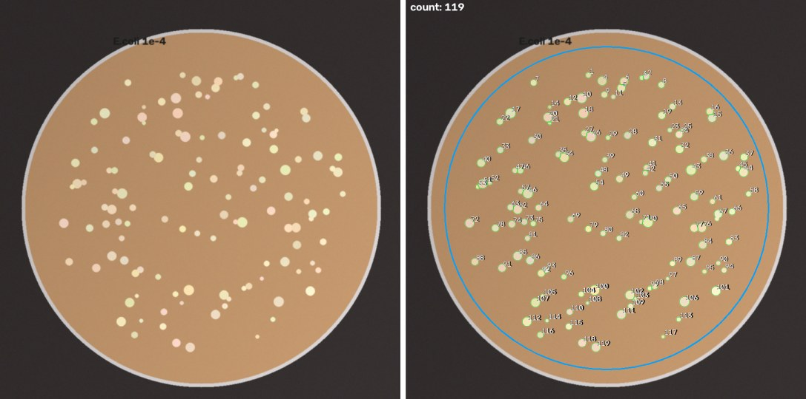
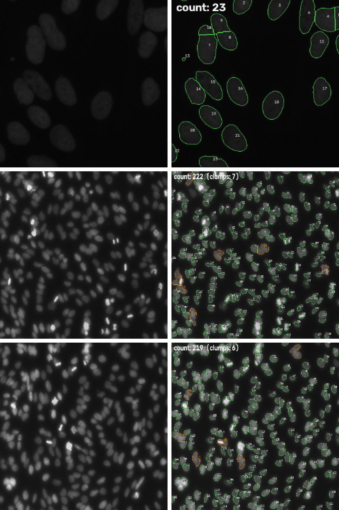
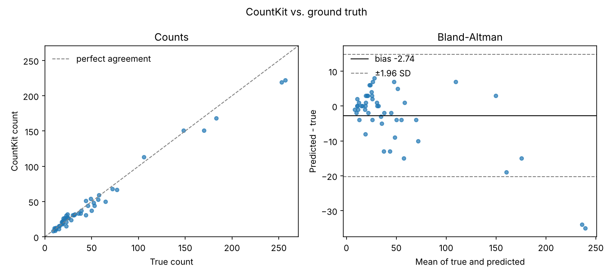
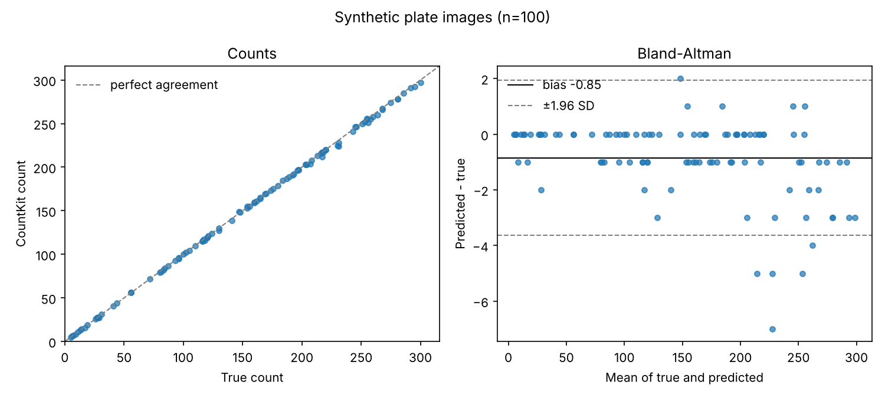

# CountKit: Colony and Cell Counting from Images

> Drop in a folder of plate photos or microscope images, get a count for every image in a CSV, plus overlay pictures so you can see exactly what got counted.

---

## Table of Contents

1. [Overview](#overview)
2. [Background](#background)
3. [Goals](#goals)
4. [Datasets](#datasets)
5. [Pipeline](#pipeline)
6. [Repository Structure](#repository-structure)
7. [Results](#results)
8. [Installation & Usage](#installation--usage)
9. [Output Files](#output-files)
10. [Reproducibility](#reproducibility)
11. [Future Directions](#future-directions)
12. [References](#references)
13. [Contact](#contact)

---

## Overview

CountKit counts things in images. It has two modes that share one interface:

- **`plate`**: bacterial colonies on agar plates
- **`cells`**: cells or nuclei in microscope images

You point it at a folder, pick a mode, and it gives you back:

1. `counts.csv`: one row per image (count, size stats, flags)
2. `objects.csv`: one row per counted object (position, area, shape)
3. `overlays/`: a copy of every image with each counted object outlined and numbered

There's also a small review page where you can flip through the overlays, click to add colonies it missed, and remove ones it shouldn't have counted. Your corrections get saved next to the original counts, so you never have to redo a whole plate because of one mistake.



*Left: a plate photo. Right: the overlay CountKit writes. The blue circle is the area that gets counted, so the rim and the label are left out.*

---

## Background

Counting colonies by hand is one of the most tedious jobs in a lab. You sit with a marker and a clicker, dot every colony on the back of the plate, and hope you didn't lose track halfway through. It takes a few minutes per plate, and two people counting the same plate often get different numbers.

Cell counting from microscope images has the same problem at a smaller scale. Hundreds of cells per field, lots of fields per experiment.

Both jobs come down to the same three steps: **find the objects, count them, measure them**. So CountKit handles both with one tool and one output format.

**Why two engines?**

| Mode | Engine | Why |
|------|--------|-----|
| `plate` | Classic image processing (OpenCV + scikit-image) | Colonies are round, high contrast blobs on a flat background. Thresholding and a watershed handle that well, run in under a second, and need no GPU or model download. |
| `cells` | [Cellpose](https://github.com/MouseLand/cellpose) (pretrained deep learning) | Cells come in every shape and touch each other constantly. Cellpose was trained on a large set of cell images and deals with that much better than thresholding. |
| `cells` | Classic fallback | Threshold + watershed. Used when Cellpose isn't installed. Good enough for clean fluorescent nuclei. |

**Why overlays?**
A number on its own isn't worth much. If a tool says "143 colonies" you have no idea whether it counted a bubble, missed a cluster, or counted the label on the plate. The overlay shows every counted object with a number on it, so you can check it in a few seconds and trust the CSV.

---

## Goals

- Count colonies and cells from images with no manual clicking
- Use the same CSV format for both modes so downstream analysis doesn't care which one you ran
- Make every count checkable by eye through overlays
- Make fixing mistakes quick instead of all or nothing
- Measure accuracy against known counts and report the real numbers

---

## Datasets

| Dataset | Used for | Status |
|---------|----------|--------|
| **Synthetic plates** (`countkit demo`) | Testing and the numbers in [Results](#results) | Included. Generated by `countkit/synth.py` with known counts |
| **Synthetic nuclei** (`countkit demo`) | Testing and the numbers in [Results](#results) | Included. Generated by `countkit/synth.py` with known counts |
| **DSB2018 nuclei** (real) | Real cell validation | **Done.** 50 test images, results below |
| [AGAR](https://agar.neurosys.com/) | Real plate validation | Not run yet. Script ready: `scripts/truth_from_agar.py` |
| [BBBC005](https://bbbc.broadinstitute.org/BBBC005) | More cell validation | Not run yet. Script ready: `scripts/truth_from_bbbc005.py` |

**DSB2018** is a set of real fluorescence microscope images of nuclei from the 2018 Data Science Bowl, where every nucleus was outlined by hand. I used the copy the StarDist project hosts on GitHub ([`dsb2018.zip`](https://github.com/stardist/stardist/releases/download/0.1.0/dsb2018.zip)), which is already split into 447 training images and 50 test images. The true count for each image is the number of hand-drawn outlines (`scripts/truth_from_masks.py`). The data isn't stored in this repo.

> **Be clear about what the synthetic numbers mean.** The synthetic images are much cleaner than real plates and real cells: even lighting, round objects, no bubbles, no condensation, no scratches. They show the code works and the counting logic is right. They do **not** tell you how accurate CountKit is on real lab images. The DSB2018 numbers are the real ones for cells. There are no real plate numbers yet.

> Check the license on each dataset before you share anything built from it.

---

## Pipeline

### Part 1: Load

- Reads PNG, JPG, TIFF, BMP
- 16-bit microscope TIFFs get stretched to 8-bit (0.5 to 99.5 percentile) so every image is handled the same way

### Part 2a: Plate mode (`countkit/plate.py`)

1. **Find the plate.** A Hough circle search finds the dish. Only the inner 90% of the radius is kept (`--rim`), which cuts out the rim glare and anything written on the edge.
2. **Remove the background.** A large median filter estimates the agar, and it gets subtracted. This handles uneven lighting, and it works whether colonies are lighter or darker than the agar.
3. **Threshold.** Otsu's method on what's left, inside the plate only.
4. **Split touching colonies.** Distance transform + watershed (`countkit/split.py`).
5. **Filter.** Drops specks smaller than `--min-area` and blobs bigger than `--max-area` (glare, smears, labels).

### Part 2b: Cells mode (`countkit/cells.py`)

- **Cellpose engine:** runs the pretrained model (`cyto3` by default) and takes its masks as is
- **Classic engine:** blur, flatten illumination with a morphological opening, Otsu threshold, watershed split
- `--engine auto` uses Cellpose if it's installed and falls back to classic if it isn't

### Part 3: Measure (`countkit/measure.py`)

For every object: center (x, y), area, equivalent diameter, circularity.

**Clump flag:** an object is flagged as a possible clump if it's more than 2x the median area **and** not convex (solidity under 0.9). Size alone isn't used, because a big round colony is still one colony.

**Image flags:**

| Flag | Meaning |
|------|---------|
| `no_plate_found` | No dish circle was found, so the whole image was used |
| `large_blob_removed` | Something bigger than `--max-area` was thrown out. Worth a look |
| `low_count` | Fewer than 3 objects |
| `many_clumps` | Over 20% of objects are flagged clumps, so the count is probably low |
| `no_cells_found` | Cells mode found nothing |

### Part 4: Overlay (`countkit/overlay.py`)

- Green outline = counted object, orange = flagged clump
- Every object numbered (the number matches `object_id` in `objects.csv`)
- Blue circle = the counting area in plate mode
- Total count printed in the corner

### Part 5: Review (`countkit/review_app.py`)

A Streamlit page:

- Flip through images with Previous / Next
- **Click** on a missed object to add it
- **Pick numbers** from a list to remove false hits
- **Save** writes `corrections.json` and `counts_corrected.csv`

### Part 6: Validate (`countkit/validate.py`)

Compares `counts.csv` to a truth file (`image,true_count`) and reports:

- Mean absolute error, mean and median % error
- Share of images within ±5% and ±10%
- Bias (does it over or undercount?)
- Pearson r
- An agreement plot and a Bland-Altman plot

---

## Repository Structure

```
countkit/
│
├── README.md                        # This file
├── RESULTS.md                       # Walkthrough of every output + current numbers
├── pyproject.toml                   # Package + `countkit` command
├── requirements.txt                 # Pinned-ish dependencies
├── LICENSE
├── .gitignore
│
├── countkit/
│   ├── cli.py                       # count / validate / demo / review commands
│   ├── io.py                        # Finding and loading images
│   ├── plate.py                     # Colony engine
│   ├── cells.py                     # Cellpose + classic cell engines
│   ├── split.py                     # Watershed for touching objects
│   ├── measure.py                   # Per-object stats, per-image summary, clump flag
│   ├── overlay.py                   # Outlined + numbered overlay images
│   ├── pipeline.py                  # Runs a folder, writes CSVs and overlays
│   ├── validate.py                  # Accuracy vs. ground truth + plots
│   ├── corrections.py               # Load/save/apply manual fixes
│   ├── review_app.py                # Streamlit review page
│   └── synth.py                     # Synthetic images with known counts
│
├── scripts/
│   ├── truth_from_agar.py           # Build truth.csv from AGAR annotations
│   ├── truth_from_bbbc005.py        # Build truth.csv from BBBC005 file names
│   └── truth_from_masks.py          # Build truth.csv from instance masks (DSB2018, BBBC039)
│
├── tests/
│   ├── test_engines.py              # Plate finding, counting, splitting
│   └── test_pipeline.py             # Output format, validation math, corrections, CLI
│
└── docs/images/                     # Figures used in this README
```

---

## Results

### Real data: DSB2018 nuclei (classic engine)

50 held-out test images, 9 to 257 nuclei each, 2,460 nuclei in total.

| Metric | Value |
|--------|-------|
| Total nuclei (true / counted) | 2,460 / 2,323 |
| Exact count | 7 / 50 |
| Mean absolute error | 5.66 nuclei |
| Mean absolute % error | 12.29% |
| Median absolute % error | 10.66% |
| Within ±5% | 22.0% of images |
| Within ±10% | 48.0% of images |
| Bias | -2.74 (undercounts) |
| Pearson r | 0.9935 |
| Time per image | 0.059 s mean |

**How it was tested:** the one setting that mattered (`min_distance`, how close two nuclei can be before they get split) was tuned on the 447 **training** images only. The best value there was 7 px, so that's now the default for cells. Then the 50 **test** images were run once. Before tuning, the test score with the old default was 15.89% mean absolute % error.

**Where it goes wrong:**
- Crowded fields with both bright and dim nuclei. One threshold for the whole image picks up the bright ones and misses some dim ones. The two worst test images had 257 and 253 nuclei and were counted as 222 and 219.
- Nuclei touching end to end sometimes get merged (orange outlines), and long nuclei sometimes get cut in two.
- Errors go both ways: 19 images overcounted, 24 undercounted, 7 exact.



*Left: real images. Right: CountKit overlays. Top: a typical image (true 20, counted 23). Middle and bottom: the two worst misses (true 257 and 253, counted 222 and 219).*



**What this means:** the classic engine is fine for a rough count on clean fluorescent nuclei, but around 1 in 2 images comes out more than 10% off. That's why Cellpose is the main engine for cells mode. Cellpose hasn't been run against this set yet (see below).

### Synthetic data

From `countkit demo -n 100`: 100 synthetic plates and 100 synthetic nuclei images, each with a known count. **These are a check that the code works, not a measure of real accuracy.**

| Metric | Plates | Cells (classic engine) |
|--------|--------|------------------------|
| Images | 100 | 100 |
| True count range | 5 to 300 | 5 to 100 |
| Total objects (true / counted) | 15,526 / 15,477 | 5,060 / 5,042 |
| Exact count | 60 / 100 | 83 / 100 |
| Mean absolute error | 0.53 objects | 0.18 objects |
| Mean absolute % error | 0.60% | 0.39% |
| Within ±5% | 97.0% | 99.0% |
| Largest miss | 3 objects | 2 objects |
| Bias | -0.49 (slight undercount) | -0.18 |
| Time per image | 0.239 s mean | 0.074 s mean |

Almost all plate errors are undercounts from touching colonies the watershed didn't split. You can see them in the overlay as one outline around two colonies.



All timings were measured on a 4-core Intel Xeon @ 2.10GHz cloud machine, CPU only. They include counting and measuring, not reading or writing files.

### Not measured yet

- **Real plates.** The public colony datasets (AGAR and others) couldn't be downloaded from the machine this was built on. This is the biggest gap
- **The Cellpose engine.** The code is written but hasn't been run, because Cellpose's model weights couldn't be downloaded there either
- Manual counting time to compare against

See [RESULTS.md](RESULTS.md) for every output file and how to read it.

---

## Installation & Usage

**Requirements:** Python ≥ 3.10

### 1. Clone and install

```bash
git clone https://github.com/SathvikSG/countkit.git
cd countkit
pip install -e .                 # plate mode + classic cell engine
pip install -e ".[cells]"        # adds Cellpose (pulls in PyTorch, large download)
pip install -e ".[review]"       # adds the Streamlit review page
```

### 2. Try it with no data

```bash
countkit demo --out demo -n 50
```

This makes 50 synthetic plates and 50 synthetic nuclei images, counts them, and checks the counts against the truth. Open `demo/plate_results/overlays/` to see what the output looks like.

### 3. Count your own images

```bash
# colonies
countkit count path/to/plates --mode plate --out results/plates

# cells (Cellpose if installed, otherwise classic)
countkit count path/to/images --mode cells --out results/cells

# cells, tell Cellpose the typical diameter in pixels (faster + usually better)
countkit count path/to/images --mode cells --diameter 30 --out results/cells
```

**Settings you might need to change:**

| Option | Default | Change it when |
|--------|---------|----------------|
| `--rim` | 0.90 | Colonies near the edge are being skipped (raise it) or the rim is getting counted (lower it) |
| `--min-area` | 12 plate, 15 cells | Dust is being counted (raise) or tiny colonies are missed (lower) |
| `--max-area` | 20000 | Your colonies are very large |
| `--min-distance` | 3 plate, 7 cells | Touching colonies stay merged (lower) or single colonies get cut in half (raise) |
| `--clump-factor` | 2.0 | Too many or too few clump flags |
| `--engine` | auto | Force `cellpose` or `classic` |
| `--dark-cells` | off | Classic engine, cells darker than background (brightfield) |

The plate defaults were picked on synthetic plates. The cell defaults were tuned on the DSB2018 training images. Run a few of your own images, look at the overlays, and adjust.

### 4. Review and fix

```bash
countkit review results/plates
```

Opens the review page in your browser. Corrections save to `results/plates/corrections.json` and `results/plates/counts_corrected.csv`.

### 5. Check accuracy against hand counts

Make a CSV with two columns, `image` and `true_count`:

```
image,true_count
plate_01.jpg,143
plate_02.jpg,87
```

Then:

```bash
countkit validate --counts results/plates/counts.csv --truth hand_counts.csv --out results/validation
```

For the public datasets, the scripts build the truth file for you:

```bash
python scripts/truth_from_bbbc005.py path/to/BBBC005_images --out bbbc_truth.csv
python scripts/truth_from_agar.py path/to/agar_folder --out agar_truth.csv
python scripts/truth_from_masks.py path/to/masks --out truth.csv     # any set with instance masks
```

**To rerun the DSB2018 test:**

```bash
curl -L -o dsb2018.zip https://github.com/stardist/stardist/releases/download/0.1.0/dsb2018.zip
unzip -q dsb2018.zip -d data
python scripts/truth_from_masks.py data/dsb2018/test/masks --out data/dsb_truth.csv
countkit count data/dsb2018/test/images --mode cells --engine classic --out results/dsb2018
countkit validate --counts results/dsb2018/counts.csv --truth data/dsb_truth.csv --out results/dsb2018/validation
```

### 6. Run the tests

```bash
pip install -e ".[dev]"
pytest
```

---

## Output Files

### From `countkit count`

| File | Contents |
|------|----------|
| `counts.csv` | One row per image: count, clumps, area stats, time, flags |
| `objects.csv` | One row per object: id, x, y, area, diameter, circularity, clump flag |
| `overlays/*_overlay.png` | Each image with every object outlined and numbered |

### From `countkit review`

| File | Contents |
|------|----------|
| `corrections.json` | Removed object ids and added click points, per image |
| `counts_corrected.csv` | `counts.csv` plus `corrected_count` and `reviewed` columns |

### From `countkit validate`

| File | Contents |
|------|----------|
| `validation_per_image.csv` | Predicted, true, error, % error for each image |
| `validation_summary.txt` | All the accuracy metrics in plain text |
| `agreement.png` | Predicted vs. true scatter + Bland-Altman plot |

Column by column details are in [RESULTS.md](RESULTS.md).

---

## Reproducibility

- Everything runs from the command line. No manual steps except the optional review
- The DSB2018 test can be rerun with the commands under [Installation & Usage](#installation--usage)
- The synthetic data is seeded, so `countkit demo -n 100 --seed 0` gives the same images and the same numbers every time
- Settings live in two small dataclasses (`PlateSettings`, `CellSettings`) so it's clear what each run used
- Manual corrections are stored separately and never overwrite the automatic counts
- 17 tests cover plate finding, counting, splitting, output format, validation math, corrections, and the CLI

**Built and tested with:** Python 3.13.16, OpenCV 5.0.0, scikit-image 0.26.0, NumPy 2.5.3, SciPy 1.18.1, pandas 3.0.5

---

## Future Directions

- [x] Validate cells mode on real data (DSB2018)
- [ ] Validate plate mode on real plates (AGAR)
- [ ] Run Cellpose on DSB2018 and compare it to the classic engine
- [ ] Local thresholding for fields with bright and dim nuclei mixed
- [ ] Time manual counting vs. CountKit on the same plates
- [ ] Guess the mode (plate or cells) from the image
- [ ] Count colonies by color (e.g. blue/white screening)
- [ ] Better splitting for big clusters of touching colonies
- [ ] Give it to a lab and log real use

---

## References

1. Stringer, C., Wang, T., Michaelos, M., Pachitariu, M. (2021). Cellpose: a generalist algorithm for cellular segmentation. *Nature Methods*, 18, 100-106.
2. Majchrowska, S. et al. (2021). AGAR a microbial colony dataset for deep learning detection. *arXiv:2108.01234*.
3. Ljosa, V., Sokolnicki, K.L., Carpenter, A.E. (2012). Annotated high-throughput microscopy image sets for validation. *Nature Methods*, 9, 637.
4. van der Walt, S. et al. (2014). scikit-image: image processing in Python. *PeerJ*, 2, e453.
5. Bradski, G. (2000). The OpenCV Library. *Dr. Dobb's Journal of Software Tools*.
6. Caicedo, J.C. et al. (2019). Nucleus segmentation across imaging experiments: the 2018 Data Science Bowl. *Nature Methods*, 16, 1247-1253.
7. Schmidt, U., Weigert, M., Broaddus, C., Myers, G. (2018). Cell detection with star-convex polygons. *MICCAI 2018*.
8. Bland, J.M., Altman, D.G. (1986). Statistical methods for assessing agreement between two methods of clinical measurement. *The Lancet*, 327(8476), 307-310.

---

## Contact

**Sathvik Sai Guntha**  
sathvik.guntha@gmail.com  
[linkedin.com/in/sathvik-sai-guntha](https://linkedin.com/in/sathvik-sai-guntha)

---

## License

Apache License 2.0. Use it, change it, build on it. See [LICENSE](LICENSE).
