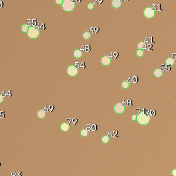
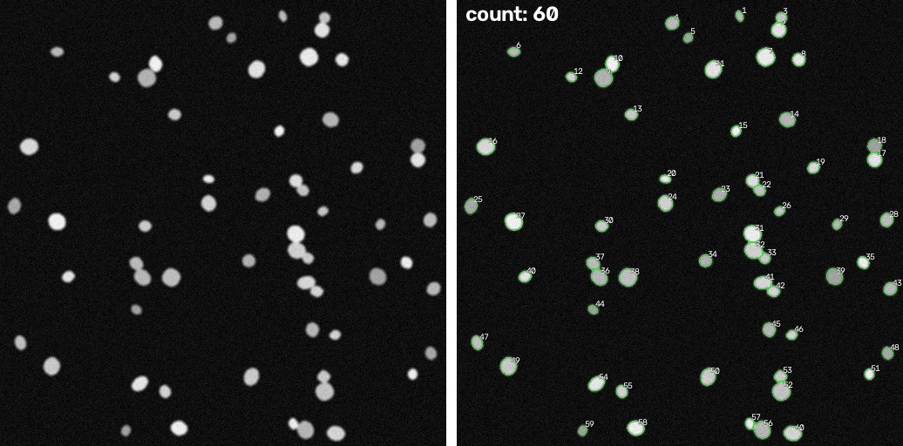
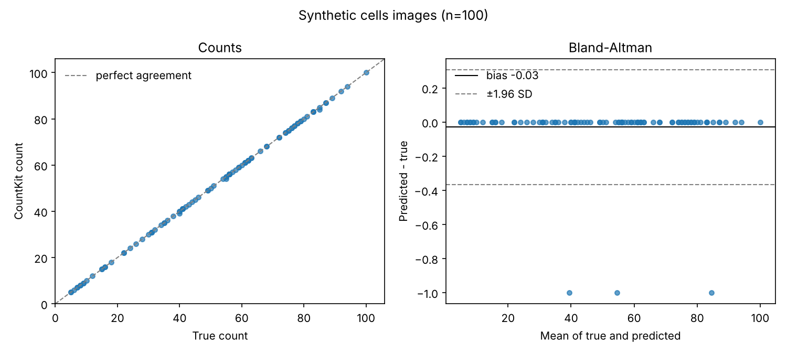

# Results & Outputs

This walks through every file CountKit writes: what's in it, how to read it, and what to look for. The numbers come from two runs: real nuclei images from DSB2018 (50 test images), and the synthetic demo (`countkit demo -n 100 --seed 0`). There are no real plate results yet.

---

## Table of Contents

1. [Summary Statistics](#summary-statistics)
2. [Figures](#figures)
   - [Overlays](#1-overlays)
   - [Agreement Plot](#2-agreement-plot)
   - [Bland-Altman Plot](#3-bland-altman-plot)
3. [Results Tables](#results-tables)
   - [counts.csv](#1-countscsv)
   - [objects.csv](#2-objectscsv)
   - [validation_per_image.csv](#3-validation_per_imagecsv)
   - [Corrections](#4-corrections)
4. [Interpreting the Numbers](#interpreting-the-numbers)

---

## Summary Statistics

`countkit validate` writes a plain text summary to `validation_summary.txt`. These are copied as written.

**Real nuclei, DSB2018 test set, classic engine (50 images, 9 to 257 nuclei each):**

```
Images compared:          50
Mean absolute error:      5.66 objects
Mean absolute % error:    12.29%
Median absolute % error:  10.66%
Within ±5% of truth:      22.0% of images
Within ±10% of truth:     48.0% of images
Bias (pred - truth):      -2.74 objects (negative = undercounting)
Pearson r:                0.9935
```

This is the number that matters for cells. The cell settings were tuned on the 447 DSB2018 training images, and this test set was run once after that.

**Synthetic plates (100 images, 5 to 300 colonies each):**

```
Images compared:          100
Mean absolute error:      0.53 objects
Mean absolute % error:    0.60%
Median absolute % error:  0.00%
Within ±5% of truth:      97.0% of images
Within ±10% of truth:     98.0% of images
Bias (pred - truth):      -0.49 objects (negative = undercounting)
Pearson r:                1.0000
```

**Synthetic nuclei, classic engine (100 images, 5 to 100 nuclei each):**

```
Images compared:          100
Mean absolute error:      0.18 objects
Mean absolute % error:    0.39%
Median absolute % error:  0.00%
Within ±5% of truth:      99.0% of images
Within ±10% of truth:     100.0% of images
Bias (pred - truth):      -0.18 objects (negative = undercounting)
Pearson r:                0.9999
```

The plate Pearson r prints as 1.0000 because it's rounded to 4 decimals. It isn't exactly 1.

Compare the synthetic cells (0.39%) with the real ones (12.29%). That gap is why synthetic numbers don't count as validation.

**Reminder:** synthetic images are a lot easier than real ones. These numbers show the code does what it's supposed to. They aren't a claim about accuracy on real plates or real cells.

---

## Figures

### 1. Overlays

**Files:** `overlays/<image>_overlay.png`, one for each input image




*Real DSB2018 nuclei. Top: typical image. Middle and bottom: the two worst misses.*



**What it shows:** the original image with every counted object outlined and numbered. The total count is in the top left corner.

| Color | Meaning |
|-------|---------|
| Green outline | Counted object |
| Orange outline + number | Flagged as a possible clump (more than one object counted as one) |
| Blue circle | Plate mode only: the counting area. Anything outside it is ignored |

**What to look for:**

- Every colony / cell has an outline ✓
- No outlines on things that aren't objects: bubbles, dust, the label, the rim ✓
- Orange outlines. Each one may be 2+ objects counted as 1. Fix them in the review page
- The blue circle sitting just inside the dish wall. If it's way off, the plate wasn't found properly (check for a `no_plate_found` flag)

---

### 2. Agreement Plot

**File:** `agreement.png` (left panel)


**What it shows:** each dot is one image. The x-axis is the true count and the y-axis is CountKit's count. The dashed line is perfect agreement.


The real DSB2018 run is above. Most dots sit close to the line, but the crowded images (200+ nuclei) fall below it: dim nuclei get missed when bright ones set the threshold.

**What to look for:**

- Dots sitting on the line ✓
- Dots drifting below the line as counts go up. That means touching colonies aren't being split on crowded plates
- Single dots far from the line. Open those overlays first

---

### 3. Bland-Altman Plot

**File:** `agreement.png` (right panel)



**What it shows:** the error (predicted minus true) for each image, against the average of the two counts. The solid line is the average error (bias). The dashed lines are bias ± 1.96 standard deviations, which is where about 95% of images should land.

**What to look for:**

- Bias close to 0. Below 0 means it undercounts, above 0 means it overcounts
- Narrow dashed lines = consistent
- Error growing as counts go up (a funnel shape). Common for colony counting, since crowded plates have more touching colonies

In the plate demo, the errors are 0, -1, -2 or -3, plus two images at +1. The negative ones are touching pairs that stayed merged.

---

## Results Tables

### 1. counts.csv

One row per image.

| Column | Description |
|--------|-------------|
| `image` | File name |
| `mode` | `plate` or `cells` |
| `engine` | `classic` or `cellpose` |
| `count` | Number of objects |
| `clumps` | How many of those were flagged as possible clumps |
| `mean_area_px` | Average object area, in pixels |
| `median_area_px` | Median object area |
| `sd_area_px` | Standard deviation of area |
| `area_p10_px` | 10th percentile area (small end) |
| `area_p90_px` | 90th percentile area (large end) |
| `seconds` | Time to count and measure this image |
| `flags` | Anything worth a second look, separated by `;` |

**Example rows (demo):**

| image | mode | engine | count | clumps | mean_area_px | median_area_px | seconds |
|-------|------|--------|-------|--------|--------------|----------------|---------|
| plate_001.png | plate | classic | 254 | 0 | 208.1 | 181.0 | 0.319 |
| plate_002.png | plate | classic | 192 | 0 | 195.2 | 181.0 | 0.307 |
| cells_001.png | cells | classic | 79 | 0 | 208.4 | 207.0 | 0.095 |

---

### 2. objects.csv

One row per counted object, across all images.

| Column | Description |
|--------|-------------|
| `image` | File name |
| `object_id` | The number drawn on the overlay |
| `x`, `y` | Center, in pixels |
| `area_px` | Area in pixels |
| `diameter_px` | Diameter of a circle with the same area |
| `circularity` | 1.0 = perfect circle, lower = more irregular |
| `is_clump` | `True` if flagged as a possible clump |

**Example rows (demo):**

| image | object_id | x | y | area_px | diameter_px | circularity | is_clump |
|-------|-----------|---|---|---------|-------------|-------------|----------|
| plate_001.png | 1 | 421.0 | 117.0 | 223 | 16.85 | 1.0 | False |
| plate_001.png | 2 | 511.0 | 128.0 | 430 | 23.4 | 0.988 | False |

Areas are in pixels. To get µm² or mm², multiply by your pixel size squared.

---

### 3. validation_per_image.csv

| Column | Description |
|--------|-------------|
| `image` | File name |
| `predicted` | CountKit count |
| `true_count` | Count from your truth file |
| `error` | predicted - true |
| `abs_error` | Absolute error |
| `pct_error` | Error as % of the true count (blank when the true count is 0) |

**Example rows (demo):**

| image | predicted | true_count | error | pct_error |
|-------|-----------|------------|-------|-----------|
| plate_001.png | 254 | 256 | -2 | -0.78125 |
| plate_002.png | 192 | 193 | -1 | -0.5181347150259067 |

---

### 4. Corrections

**`corrections.json`**, written by the review page:

```json
{
  "plate_001.png": {
    "added": [[412.5, 233.0]],
    "removed": [17, 42]
  }
}
```

- `removed`: object ids (from the overlay) that weren't real
- `added`: (x, y) spots you clicked for objects it missed

**`counts_corrected.csv`** is `counts.csv` with two more columns:

| Column | Description |
|--------|-------------|
| `corrected_count` | `count` - removed + added |
| `reviewed` | `True` if you opened that image in the review page |

---

## Interpreting the Numbers

**Mean absolute % error:** on average, how far off the count is as a share of the true count. 2% on a 150-colony plate is about 3 colonies.

**Within ±5%:** the share of images where the count was close enough that most people wouldn't recount. This is the easiest number to explain to someone else.

**Bias:** tells you which way it's wrong. Colony counters almost always undercount, because touching colonies get merged. If you see a positive bias, it's counting things that aren't colonies (dust, bubbles, the rim).

**Percent error on low counts:** missing 1 colony out of 5 is 20% error. Look at absolute error for sparse plates, and % error for crowded ones.

**Pearson r:** high r just means counts go up and down together. A tool that always counts half the real number would still have r close to 1. Always read it next to bias.

**Area in pixels:** only comparable between images taken at the same magnification and resolution.
