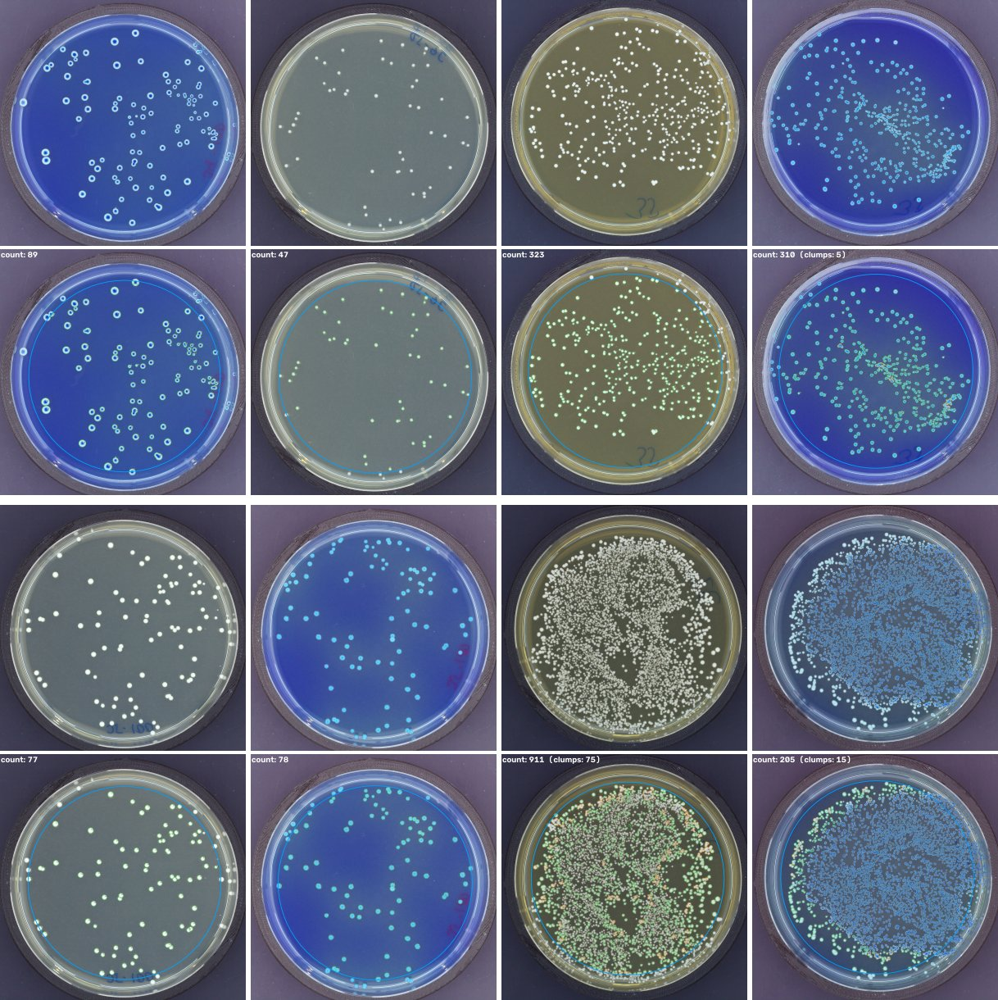

# Results & Outputs

This walks through every file CountKit writes: what's in it, how to read it, and what to look for. The numbers come from three sets: real nuclei images from DSB2018 (50 test images), real hand-counted plates from the AGAR demo (19 held-out plates), and the synthetic demo (`countkit demo -n 100 --seed 0`).

---

## Table of Contents

1. [Summary Statistics](#summary-statistics)
2. [Figures](#figures)
   - [Overlays](#1-overlays)
   - [Agreement Plot](#2-agreement-plot)
   - [Bland-Altman Plot](#3-bland-altman-plot)
3. [Results Tables](#results-tables)
   - [counts.csv](#1-countscsv)
   - [objects.csv](#2-objectscsv)
   - [validation_per_image.csv](#3-validation_per_imagecsv)
   - [Corrections](#4-corrections)
4. [Interpreting the Numbers](#interpreting-the-numbers)

---

## Summary Statistics

`countkit validate` writes a plain text summary to `validation_summary.txt`. These are copied as written.

**Real nuclei, DSB2018 test set, Cellpose engine (50 images, 9 to 257 nuclei each):**

```
Images compared:          50
Mean absolute error:      1.70 objects
Mean absolute % error:    4.67%
Median absolute % error:  3.03%
Within ±5% of truth:      66.0% of images
Within ±10% of truth:     88.0% of images
Bias (pred - truth):      -0.66 objects (negative = undercounting)
Pearson r:                0.9989
```

Cellpose 4.2 (Cellpose-SAM) with default settings, nothing tuned. Its training data may include DSB2018, so this could be a bit better than on brand new images.

**Real nuclei, DSB2018 test set, classic engine (same 50 images):**

```
Images compared:          50
Mean absolute error:      5.66 objects
Mean absolute % error:    12.29%
Median absolute % error:  10.66%
Within ±5% of truth:      22.0% of images
Within ±10% of truth:     48.0% of images
Bias (pred - truth):      -2.74 objects (negative = undercounting)
Pearson r:                0.9935
```

The classic engine's settings were tuned on the 447 DSB2018 training images, and this test set was run once after that.

**Real plates, AGAR demo, held-out set (19 plates, 3 to 298 colonies each):**

```
Images compared:          19
Mean absolute error:      19.79 objects
Mean absolute % error:    116.62%
Median absolute % error:  51.22%
Within ±5% of truth:      10.5% of images
Within ±10% of truth:     21.1% of images
Bias (pred - truth):      -5.47 objects (negative = undercounting)
Pearson r:                0.9371
```

This is the number that matters for plates, and it's not great. Plate mode gives a ballpark on real plates, not a final count. The settings were tuned on 20 other AGAR plates. The big mean comes from plates with only 3 to 10 colonies, where printed text on the dish adds 10 or more false hits. The README has the full story, including an earlier run on the same 19 plates (31.21% median).

**Synthetic plates (100 images, 5 to 300 colonies each):**

```
Images compared:          100
Mean absolute error:      4.45 objects
Mean absolute % error:    2.83%
Median absolute % error:  2.53%
Within ±5% of truth:      92.0% of images
Within ±10% of truth:     98.0% of images
Bias (pred - truth):      -4.45 objects (negative = undercounting)
Pearson r:                0.9997
```

**Synthetic nuclei, classic engine (100 images, 5 to 100 nuclei each):**

```
Images compared:          100
Mean absolute error:      0.18 objects
Mean absolute % error:    0.39%
Median absolute % error:  0.00%
Within ±5% of truth:      99.0% of images
Within ±10% of truth:     100.0% of images
Bias (pred - truth):      -0.18 objects (negative = undercounting)
Pearson r:                0.9999
```

Compare the synthetic cells (0.39%) with the real ones (12.29%), or the synthetic plates (2.83%) with the real ones (51.22%). That gap is why synthetic numbers don't count as validation.

**Real plate photos (8 scans, no hand counts):** counts are 89, 47, 323, 310, 77 and 78 on the six normal plates, and 911 and 205 on two plates that got the `crowded_plate` flag. Colonies right at the edge are skipped by the default rim (0.85); `--rim 0.9` counts them on clean plates like these. There's no accuracy number without hand counts. Running these is how three bugs got found and fixed (big photos split into pieces, ring-shaped colonies split into pieces, no warning for overgrown plates). Details are in the README under Results.

**Reminder:** synthetic images are a lot easier than real ones. These numbers show the code does what it's supposed to. They aren't a claim about accuracy on real plates or real cells.

---

## Figures

### 1. Overlays

**Files:** `overlays/<image>_overlay.png`, one for each input image



*Real plate scans (top of each pair) and their overlays (bottom).*


*Real DSB2018 nuclei. Top: typical image. Middle and bottom: the two worst misses.*


**What it shows:** the original image with every counted object outlined and numbered. The total count is in the top left corner.

| Color | Meaning |
|-------|---------|
| Green outline | Counted object |
| Orange outline + number | Flagged as a possible clump (more than one object counted as one) |
| Blue circle | Plate mode only: the counting area. Anything outside it is ignored |

**What to look for:**

- Every colony / cell has an outline ✓
- No outlines on things that aren't objects: bubbles, dust, the label, the rim ✓
- Orange outlines. Each one may be 2+ objects counted as 1. Fix them in the review page
- The blue circle sitting just inside the dish wall. If it's way off, the plate wasn't found properly (check for a `no_plate_found` flag)
- A `crowded_plate` flag. The plate is too packed for single colonies to be told apart, so treat the number as "too many to count"

---

### 2. Agreement Plot

**File:** `agreement.png` (left panel)


**What it shows:** each dot is one image. The x-axis is the true count and the y-axis is CountKit's count. The dashed line is perfect agreement.


The real DSB2018 run is above. Most dots sit close to the line, but the crowded images (200+ nuclei) fall below it: dim nuclei get missed when bright ones set the threshold.

**What to look for:**

- Dots sitting on the line ✓
- Dots drifting below the line as counts go up. That means touching colonies aren't being split on crowded plates
- Single dots far from the line. Open those overlays first

---

### 3. Bland-Altman Plot

**File:** `agreement.png` (right panel)


**What it shows:** the error (predicted minus true) for each image, against the average of the two counts. The solid line is the average error (bias). The dashed lines are bias ± 1.96 standard deviations, which is where about 95% of images should land.

**What to look for:**

- Bias close to 0. Below 0 means it undercounts, above 0 means it overcounts
- Narrow dashed lines = consistent
- Error growing as counts go up (a funnel shape). Common for colony counting, since crowded plates have more touching colonies

In the plate demo, 13 images are exact, 24 are off by 1 or 2, and the rest range from -3 to -13. None are over. The misses are touching colonies that stayed merged.

---

## Results Tables

### 1. counts.csv

One row per image.

| Column | Description |
|--------|-------------|
| `image` | File name |
| `mode` | `plate` or `cells` |
| `engine` | `classic` or `cellpose` |
| `count` | Number of objects |
| `clumps` | How many of those were flagged as possible clumps |
| `mean_area_px` | Average object area, in pixels |
| `median_area_px` | Median object area |
| `sd_area_px` | Standard deviation of area |
| `area_p10_px` | 10th percentile area (small end) |
| `area_p90_px` | 90th percentile area (large end) |
| `seconds` | Time to count and measure this image |
| `flags` | Anything worth a second look, separated by `;` |

**Example rows (demo):**

| image | mode | engine | count | clumps | mean_area_px | median_area_px | seconds |
|-------|------|--------|-------|--------|--------------|----------------|---------|
| plate_001.png | plate | classic | 247 | 0 | 215.0 | 192.0 | 0.243 |
| plate_002.png | plate | classic | 188 | 0 | 199.2 | 180.5 | 0.204 |
| cells_001.png | cells | classic | 79 | 0 | 208.4 | 207.0 | 0.038 |

---

### 2. objects.csv

One row per counted object, across all images.

| Column | Description |
|--------|-------------|
| `image` | File name |
| `object_id` | The number drawn on the overlay |
| `x`, `y` | Center, in pixels |
| `area_px` | Area in pixels |
| `diameter_px` | Diameter of a circle with the same area |
| `circularity` | 1.0 = perfect circle, lower = more irregular |
| `is_clump` | `True` if flagged as a possible clump |

**Example rows (demo):**

| image | object_id | x | y | area_px | diameter_px | circularity | is_clump |
|-------|-----------|---|---|---------|-------------|-------------|----------|
| plate_001.png | 1 | 422.0 | 117.7 | 228 | 17.04 | 1.0 | False |
| plate_001.png | 2 | 512.0 | 128.5 | 421 | 23.15 | 0.977 | False |

Areas are in pixels. To get µm² or mm², multiply by your pixel size squared.

---

### 3. validation_per_image.csv

| Column | Description |
|--------|-------------|
| `image` | File name |
| `predicted` | CountKit count |
| `true_count` | Count from your truth file |
| `error` | predicted - true |
| `abs_error` | Absolute error |
| `pct_error` | Error as % of the true count (blank when the true count is 0) |

**Example rows (demo):**

| image | predicted | true_count | error | pct_error |
|-------|-----------|------------|-------|-----------|
| plate_001.png | 247 | 256 | -9 | -3.515625 |
| plate_002.png | 188 | 193 | -5 | -2.5906735751295336 |

---

### 4. Corrections

**`corrections.json`**, written by the review page:

```json
{
  "plate_001.png": {
    "added": [[412.5, 233.0]],
    "removed": [17, 42]
  }
}
```

- `removed`: object ids (from the overlay) that weren't real
- `added`: (x, y) spots you clicked for objects it missed

**`counts_corrected.csv`** is `counts.csv` with two more columns:

| Column | Description |
|--------|-------------|
| `corrected_count` | `count` - removed + added |
| `reviewed` | `True` if you opened that image in the review page |

---

## Interpreting the Numbers

**Mean absolute % error:** on average, how far off the count is as a share of the true count. 2% on a 150-colony plate is about 3 colonies.

**Within ±5%:** the share of images where the count was close enough that most people wouldn't recount. This is the easiest number to explain to someone else.

**Bias:** tells you which way it's wrong. Colony counters almost always undercount, because touching colonies get merged. If you see a positive bias, it's counting things that aren't colonies (dust, bubbles, the rim).

**Percent error on low counts:** missing 1 colony out of 5 is 20% error. Look at absolute error for sparse plates, and % error for crowded ones.

**Pearson r:** high r just means counts go up and down together. A tool that always counts half the real number would still have r close to 1. Always read it next to bias.

**Area in pixels:** only comparable between images taken at the same magnification and resolution.
